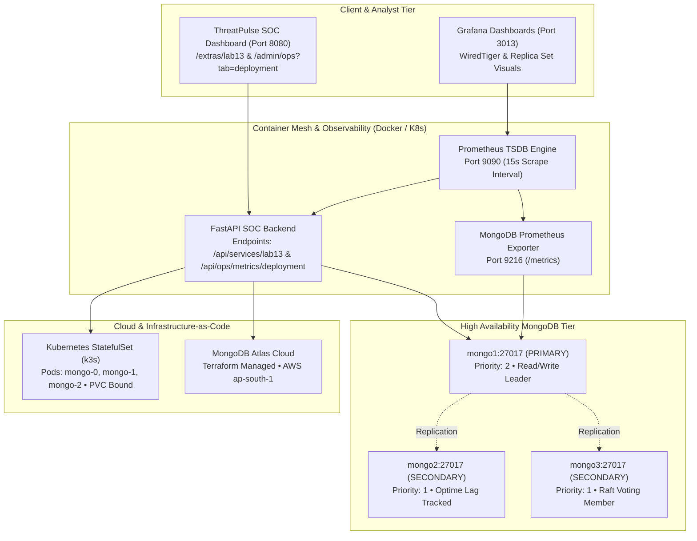

# Chapter 13 — Containers and the Cloud: Enterprise Architecture & Operational Guide

## Overview & Architecture

Chapter 13 demonstrates production container orchestration, resilient database topologies, continuous time-series telemetry, and cloud infrastructure-as-code for the **ThreatPulse NoSQL Threat Intelligence Platform**.



---

## Services & Port Allocations

| Service Name | Container / Pod | Internal Port | Host Port | Description |
|:-------------|:----------------|:--------------|:----------|:------------|
| **mongo1** | `lab13-mongo1` | 27017 | `27020` | Replica set Primary (Priority 2) |
| **mongo2** | `lab13-mongo2` | 27017 | `27018` | Secondary node 1 (Priority 1) |
| **mongo3** | `lab13-mongo3` | 27017 | `27019` | Secondary node 2 (Priority 1) |
| **mongodb-exporter** | `lab13-mongodb-exporter` | 9216 | `9216` | Percona MongoDB metrics collector |
| **prometheus** | `lab13-prometheus` | 9090 | `9090` | Prometheus TSDB metrics engine |
| **grafana** | `lab13-grafana` | 3013 | `3013` | SOC visual analytics dashboards |
| **backend** | `lab13-threatpulse-backend` | 8080 | `8080` | ThreatPulse FastAPI SOC backend & UI |

---

## Environment Variables

Configure the following variables in `.env` or your container environment:

```env
# Database Connections
MONGODB_URI=mongodb://mongo1:27017,mongo2:27017,mongo3:27017/?replicaSet=rs0
DB_NAME=threat_intel_db
COLLECTION_NAME=threat_reports

# Monitoring & Dashboards
PROMETHEUS_URL=http://localhost:9090
GRAFANA_URL=http://localhost:3013

# Host & Server
PORT=8080
HOST=0.0.0.0

# Administrator Security (Required for Failover & K8s Control)
ADMIN_API_KEY=threatpulse-soc-admin-secret-2026

# Kubernetes Configuration
KUBERNETES_NAMESPACE=default

# MongoDB Atlas & Terraform (Leave blank to show configured diagnostics)
MONGODB_ATLAS_PUBLIC_KEY=
MONGODB_ATLAS_PRIVATE_KEY=
MONGODB_ATLAS_ORG_ID=
```

---

## Docker Setup & Multi-Node Replica Set

The multi-container Docker Compose deployment spins up an active 3-node MongoDB replica set with automated quorum initialization:

```bash
# 1. Navigate to Chapter 13 directory
cd chapter-13

# 2. Start all services in the background
docker compose up -d

# 3. Verify container health status
docker compose ps
```

The `rs-init` service automatically initiates `rs0`:
```javascript
rs.initiate({
  _id: "rs0",
  members: [
    { _id: 0, host: "mongo1:27017", priority: 2 },
    { _id: 1, host: "mongo2:27017", priority: 1 },
    { _id: 2, host: "mongo3:27017", priority: 1 }
  ]
});
```

---

## Prometheus & Grafana Monitoring

1. **Prometheus Scraping (`chapter-13/prometheus/prometheus.yml`)**:
   - Collects metrics from `mongodb-exporter:9216` every 15 seconds.
   - Monitors replica set states (`mongodb_mongod_replset_member_state`), lag (`replication_lag`), connections, cache bytes, and elections.
   - Accessible at: **[http://localhost:9090](http://localhost:9090)**

2. **Grafana Dashboards (`chapter-13/grafana/`)**:
   - Pre-provisioned Prometheus datasource at `http://prometheus:9090`.
   - Pre-loaded dashboard `ThreatPulse - MongoDB Chapter 13 Replica Set & Ops Dashboard`.
   - Accessible at: **[http://localhost:3013](http://localhost:3013)** (Default login: `admin` / `AdminPass2026!`).

---

## Kubernetes StatefulSet Deployment

The Kubernetes manifests in `chapter-13/k8s/mongodb-statefulset.yaml` deploy:
- **Headless Service**: `mongodb-service` ensuring direct network addressability for each pod (`mongo-0`, `mongo-1`, `mongo-2`).
- **StatefulSet**: Ordered pod deployment with liveness and readiness health probes checking `mongosh --eval 'db.adminCommand("ping")'`.
- **PersistentVolumeClaims (PVC)**: `mongo-data` with `ReadWriteOnce` access mode, ensuring zero data loss during pod restarts or recovery tests.

To deploy to a running k3s, minikube, or kind cluster:
```bash
# Using Windows batch script:
chapter-13\k8s\deploy-k8s.bat

# Or direct kubectl command:
kubectl apply -f chapter-13/k8s/mongodb-statefulset.yaml
kubectl rollout status statefulset/mongo
```

---

## MongoDB Atlas & Terraform Provisioning

The Terraform configuration in `chapter-13/terraform/` provides automated Infrastructure-as-Code:
- `main.tf`: Defines project, `mongodbatlas_advanced_cluster` (M0 Sandbox or M10 Dedicated in AWS `AP_SOUTH_1`), database users with scoped RBAC, and IP whitelist rules.
- `variables.tf`: Parameterized keys, org ID, region, and tier.
- `outputs.tf`: Sanitized connection string and cluster ID.

To plan or deploy:
```bash
cd chapter-13/terraform
cp terraform.tfvars.example terraform.tfvars
# Fill in your authentic Atlas keys
terraform init
terraform plan
```

> **Security & Graceful Diagnostics**: If Terraform or Atlas credentials are not provided or invalid, the platform gracefully detects this state, displays the exact error (`deploymentState: "NOT_CONFIGURED" | "REFUSED"`), and provides actionable steps to rectify configuration without claiming false success.

---

## API Endpoints

### 1. `GET /api/services/lab13`
Reports live service members and their roles:
- **Replica Set**: Primary host, secondary nodes, replication lag in seconds, member health, uptime, and last failover metrics.
- **Monitoring**: Links to Grafana (`:3013`) and Prometheus (`:9090`), exporter status, Prometheus target health, and live ops/sec.
- **Kubernetes**: Status of `mongo-0`, `mongo-1`, `mongo-2`, pod recovery time, and PVC data retention status.
- **Atlas Cloud**: Cluster name, tier, region, deployment state, document counts, and Terraform validation details.

### 2. `GET /api/ops/metrics/deployment?minutes=15|30|60|360`
Returns actual Prometheus time-series data or direct MongoDB sampled telemetry buffer:
- **Operations by Type**: Queries, inserts, updates, deletes, and commands.
- **Member State Timeline**: Row per member indicating `PRIMARY` (1), `SECONDARY` (2), or `DOWN` (0).
- **Replication Lag**: Float seconds per secondary member.
- **Heartbeat Ping**: Latency in ms for inter-node communication.
- **Connections**: Current vs available client connection pool.
- **Cache Usage**: WiredTiger cache in MiB (resident vs dirty).
- **Elections**: Count of election transitions.
- **5 Summary Statistics**: Current primary, members online, ops/sec, slowest lag, and elections in period.

### 3. `POST /api/services/lab13/failover/test`
- **Requires**: Admin authentication (`X-Admin-Key` header or admin session) and explicit confirmation (`confirm=true` or payload `{ "confirmed": true }`).
- **Action**: Triggers `replSetStepDown` (30s) on primary, runs concurrent benchmark reads, records previous and new primary, election duration in ms, and read failure count.

### 4. `POST /api/services/lab13/k8s/start`
- **Requires**: Admin authorization and confirmation.
- **Action**: Initiates k3s / minikube startup or applies StatefulSet manifests.

### 5. `POST /api/services/lab13/atlas/deploy`
- **Requires**: Admin authorization and confirmation.
- **Action**: Validates credentials and initiates Terraform cloud cluster deployment.

### 6. Web Routes
- **`/extras/lab13`**: Dedicated Chapter 13 Administrator Workspace (Overview, Replica Set, Failover, Monitoring, Kubernetes, Atlas).
- **`/admin/ops?tab=deployment`**: Admin Database Operations Telemetry with period filters (15m, 30m, 1h, 6h) and auto-refreshing Chart.js visualizations.

---

## How to Run & Verify the Lab

### Option 1: Standalone / Host Development Mode

```bash
# 1. From workspace root, start the ThreatPulse server
cd MongoDB_Combined_Docker_Pipeline/lab7/backend
python main.py
```
Open your browser to:
- Chapter 13 Dedicated Workspace: **[http://localhost:8080/extras/lab13](http://localhost:8080/extras/lab13)**
- Admin Operations Telemetry: **[http://localhost:8080/admin/ops?tab=deployment](http://localhost:8080/admin/ops?tab=deployment)**

### Option 2: Full Multi-Container Docker Deployment

```bash
cd chapter-13
docker compose up -d --build
```
Verify the services:
- Dashboard: **[http://localhost:8080](http://localhost:8080)**
- Grafana: **[http://localhost:3013](http://localhost:3013)**
- Prometheus: **[http://localhost:9090](http://localhost:9090)**

### Option 3: Automated Test Suite

Run the comprehensive Chapter 13 verification test suite:
```bash
python -m pytest tests/test_chapter13.py -v
```
All unit and integration tests run with standard Python test runners without requiring external mock tampering of production telemetry.
