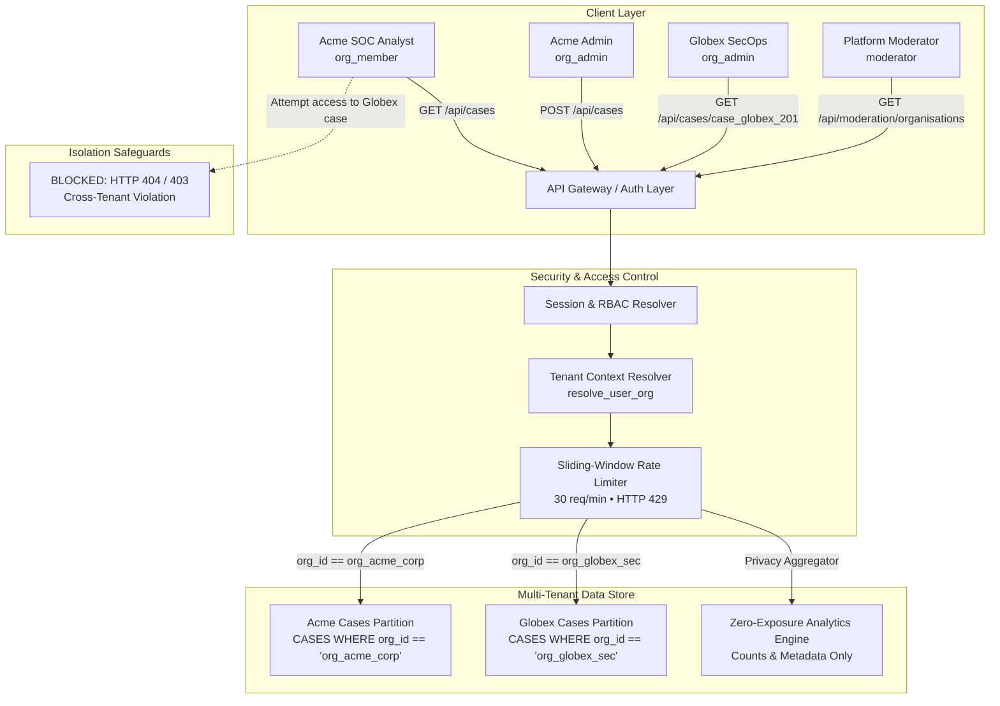

# Chapter 15: Multi-Tenant Case Management & Tenant Data Isolation

## 1. Overview & Multi-Tenant Architecture

Chapter 15 establishes an enterprise-grade **SaaS Multi-Tenant Case Management System** within the **ThreatPulse NoSQL Cyber Threat Intelligence Platform**. It enables diverse organisations (SOC teams, MSSPs, and enterprise incident response units) to operate on the same unified platform while maintaining strict, mathematically verified data isolation.

### Architectural Model: Shared Database, Scoped Tenant Partitioning

ThreatPulse adopts the **Shared Database, Isolated Document Partitioning** pattern:
- All cases reside within the secure `cases` collection.
- Every case document contains an indexed, immutable `org_id` partition key.
- Server-side authorization routines automatically scope all reads, creations, updates, and deletions by the caller's verified organisation context.
- Cross-tenant queries are rejected at the service layer with HTTP `404 Not Found` (to eliminate ID enumeration / existence disclosure) or HTTP `403 Forbidden`.



---

## 2. Organisation & Membership Model

The platform defines three baseline enterprise tenants:

| Organisation Name | Organisation ID | Slug | Tier | Max Cases | Members |
| :--- | :--- | :--- | :--- | :--- | :--- |
| **Acme Cybersecurity Corp** | `org_acme_corp` | `acme-corp` | Enterprise | 1,000 | `admin@threatpulse.io`, `analyst@threatpulse.io`, `sarah.chen@acme.com` |
| **Globex Defense Systems** | `org_globex_sec` | `globex-sec` | Professional | 500 | `secops@globex.io`, `analyst@globex.io` |
| **Stark Advanced Threats** | `org_stark_net` | `stark-net` | Enterprise | 2,000 | `jarvis@stark.io` |

Users without an organisation (e.g., `solo@freelance.org`) are gracefully presented with the empty tenant state:
> *"Ask an administrator to add you to an organisation."*

---

## 3. Role-Based Access Control (RBAC) Permissions

| Action | Organisation Administrator (`org_admin`) | Organisation Member (`org_member`) | Platform Admin (`admin`) |
| :--- | :---: | :---: | :---: |
| **View Cases** | All cases of the organisation | Cases assigned to or created by user ("Your cases") | All cases in active scoped tenant |
| **Create Case** | Yes (scoped to organisation) | Yes (scoped to organisation) | Yes |
| **Edit Case Title/Description** | Yes | Yes (if creator) | Yes |
| **Transition Case Status** | Yes (`Open`, `In Progress`, `Closed`) | Yes (if assigned or creator) | Yes |
| **Reassign Case** | Yes (must be in same org) | No | Yes |
| **Delete Case** | Yes | No | Yes |
| **View Org Members Workload** | Yes (with open/closed case stats) | No | Yes |
| **Cross-Tenant Access** | Strictly Denied (404/403) | Strictly Denied (404/403) | Switched via `X-Organization-Id` |

---

## 4. Case Document Schema

```json
{
  "_id": "case_acme_101",
  "id": "case_acme_101",
  "caseNumber": "CASE-2026-101",
  "orgId": "org_acme_corp",
  "title": "Cobalt Strike C2 Beaconing via Port 443",
  "description": "Workstation communicating with 185.220.101.5 on a 60s jitter interval.",
  "priority": "HIGH",
  "status": "In Progress",
  "assignedTo": "analyst_01",
  "assignedToName": "Security Analyst",
  "createdBy": "admin_01",
  "createdByName": "SOC Platform Administrator",
  "linkedThreat": "THREAT-APT29-BEACON",
  "linkedEvent": "EVT-90214-DNS",
  "createdAt": "2026-11-10T14:30:00Z",
  "updatedAt": "2026-11-12T09:15:00Z"
}
```

### Allowed Values:
- **Priority**: `LOW`, `MEDIUM`, `HIGH`, `CRITICAL`
- **Status**: `Open`, `In Progress`, `Closed`

---

## 5. API Reference

### Case Management Endpoints
- `GET /api/cases/me`: Returns caller identity, active tenant membership, permissions, and rate limit configuration.
- `GET /api/cases`: Returns scoped cases. Org admins receive *"All cases of the organisation"*; regular members receive *"Your cases"*. Supports `?status=`, `?priority=`, and `?search=`.
- `POST /api/cases`: Creates a case. Rate-limited. Validates that the assignee belongs to the caller's tenant.
- `GET /api/cases/{id}`: Returns a case document. Responds with HTTP 404 if the case belongs to another organisation.
- `PATCH /api/cases/{id}`: Updates status, priority, title, description, or assignee. Rate-limited. Enforces tenant and role boundaries.
- `DELETE /api/cases/{id}`: Deletes a case. Rate-limited. Requires `org_admin` role.
- `GET /api/cases/org/members`: Returns tenant members and their open, in-progress, and closed case counts.

### Multi-Tenant Analytics Endpoints
- `GET /api/moderation/organisations`: Moderator and admin analytics dashboard. Provides total organisations, members, cases, and rate limit refusals.
  - **Privacy Enforcement**: Returns counts and tenant metadata only. Strictly omits case descriptions, threat titles, indicators, or private messages.
- `GET /api/services/lab15`: Chapter 15 telemetry for the dedicated administrative workspace.

---

## 6. Rate Limiting Rules & HTTP 429 Format

Mutating case endpoints (`POST`, `PATCH`, `DELETE`) are protected by a sliding-window rate limiter:
- **Default Limit**: 30 requests per minute per client token/IP.
- **HTTP 429 Status**: Returned immediately when the threshold is exceeded.
- **HTTP Response Headers**: `Retry-After: <seconds>`
- **Response Format**:
  ```json
  {
    "detail": "Rate limit reached: 30 requests per minute. Try again in 45 seconds."
  }
  ```
- **UI Behavior**: Displays a warning alert banner with the exact server-provided retry time without silently retrying or generating duplicate records.

---

## 7. Security & Isolation Verification Runbook

### Proving Cross-Tenant Access Prevention
1. **Attempting to read another tenant's case**:
   ```bash
   # Acme Analyst attempting to read Globex case 'case_globex_201'
   curl -s -X GET "http://localhost:8000/api/cases/case_globex_201" \
     -H "Cookie: tp_session=<acme_session_token>"
   # Result: HTTP 404 Not Found {"detail": {"error": "Case 'case_globex_201' not found."}}
   ```
2. **Attempting to modify another tenant's case**:
   ```bash
   curl -s -X PATCH "http://localhost:8000/api/cases/case_globex_201" \
     -H "Content-Type: application/json" \
     -H "Cookie: tp_session=<acme_session_token>" \
     -d '{"status": "Closed"}'
   # Result: HTTP 404 Not Found
   ```
3. **Attempting cross-tenant assignment**:
   ```bash
   # Acme Admin attempting to assign case to Globex user 'user_globex_01'
   curl -s -X POST "http://localhost:8000/api/cases" \
     -H "Content-Type: application/json" \
     -H "X-Admin-Key: threatpulse_admin_secret_key_2026" \
     -d '{"title": "Cross-Tenant Probe", "description": "Testing assignment", "assignedTo": "user_globex_01"}'
   # Result: HTTP 400 Bad Request {"detail": {"error": "Assignee 'user_globex_01' is not an active member of organisation 'Acme Cybersecurity Corp'."}}
   ```

---

## 8. How to Run Chapter 15

### 1. Execute Chapter 15 Test Suite
```powershell
pytest tests/test_chapter15.py -v
```

### 2. Start the ThreatPulse SOC Server
```powershell
cd MongoDB_Combined_Docker_Pipeline/lab7/backend
uvicorn main:app --host 0.0.0.0 --port 8000 --reload
```

### 3. Access Multi-Tenant Consoles
- **Cases Page**: [http://localhost:8000/cases](http://localhost:8000/cases)
- **Admin Operations (Orgs Tab)**: [http://localhost:8000/admin/ops?tab=orgs](http://localhost:8000/admin/ops?tab=orgs)
- **Moderation Console (Orgs Tab)**: [http://localhost:8000/moderation?tab=orgs](http://localhost:8000/moderation?tab=orgs)
- **Chapter 15 Dedicated Workspace**: [http://localhost:8000/extras/lab15](http://localhost:8000/extras/lab15)

